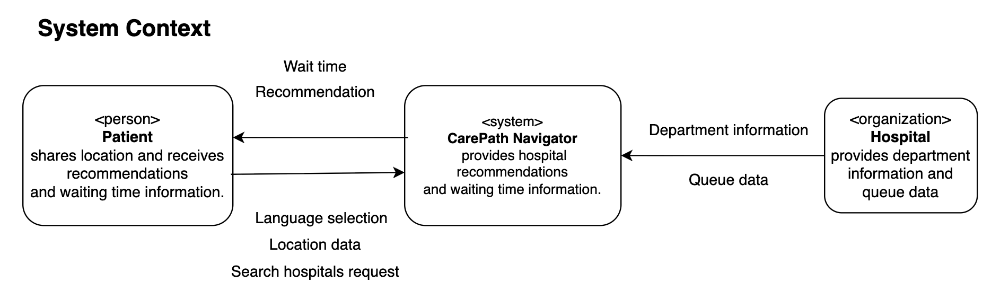
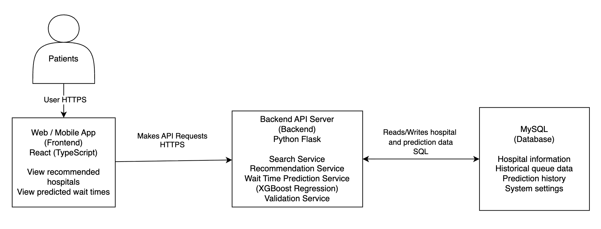
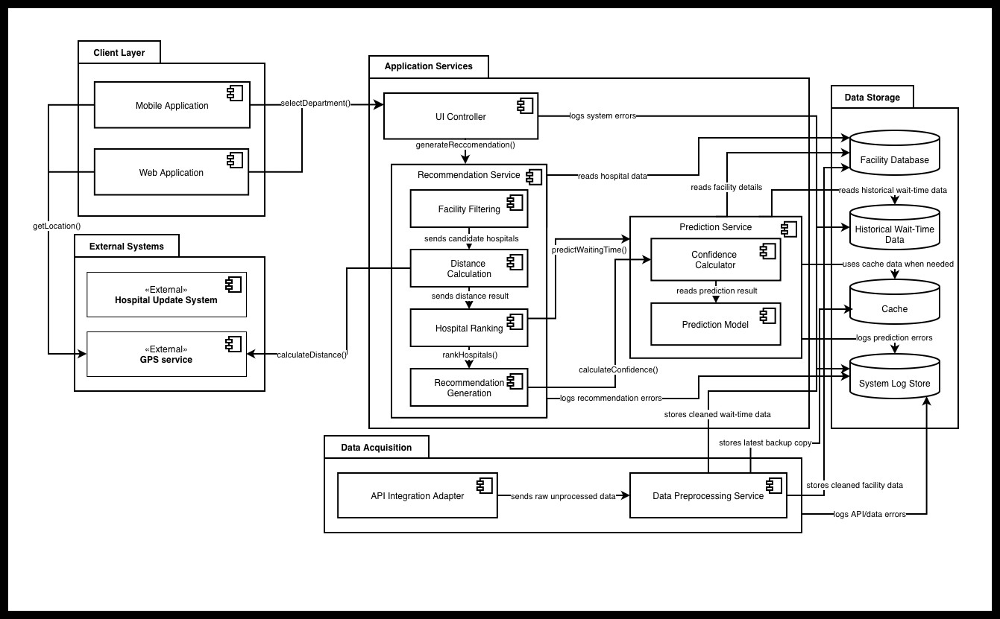
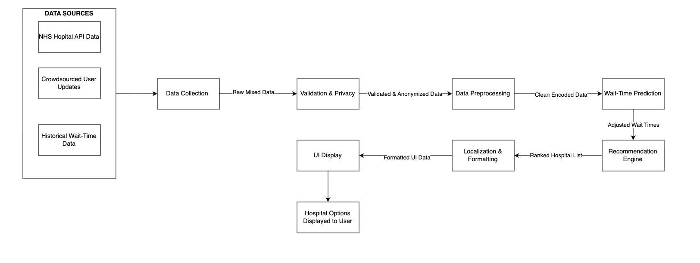
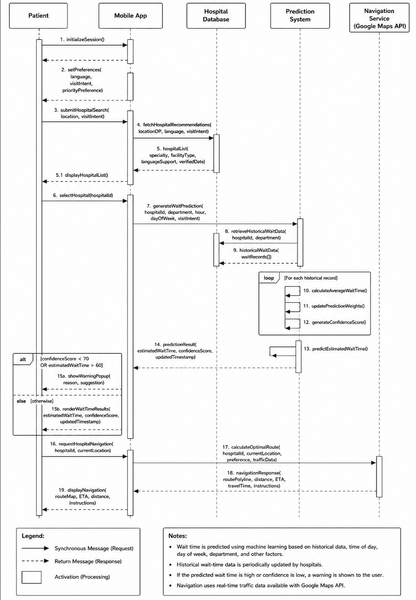
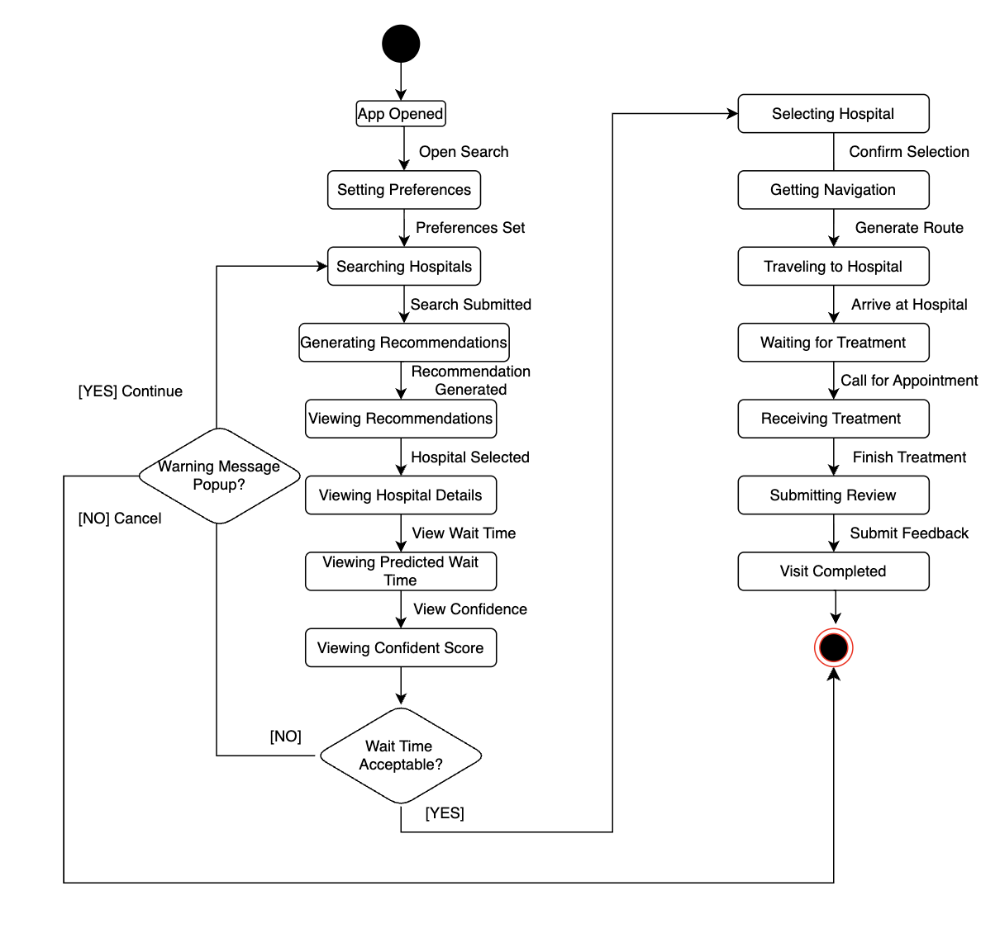
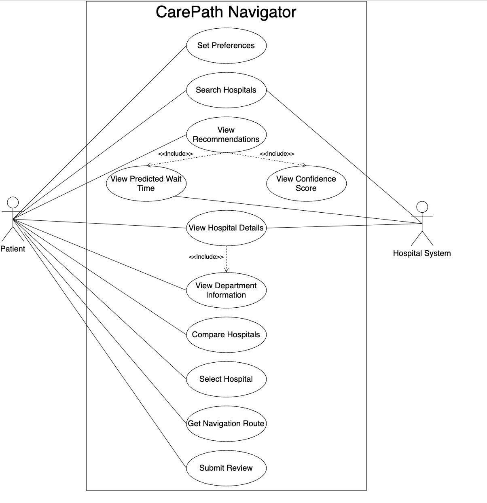
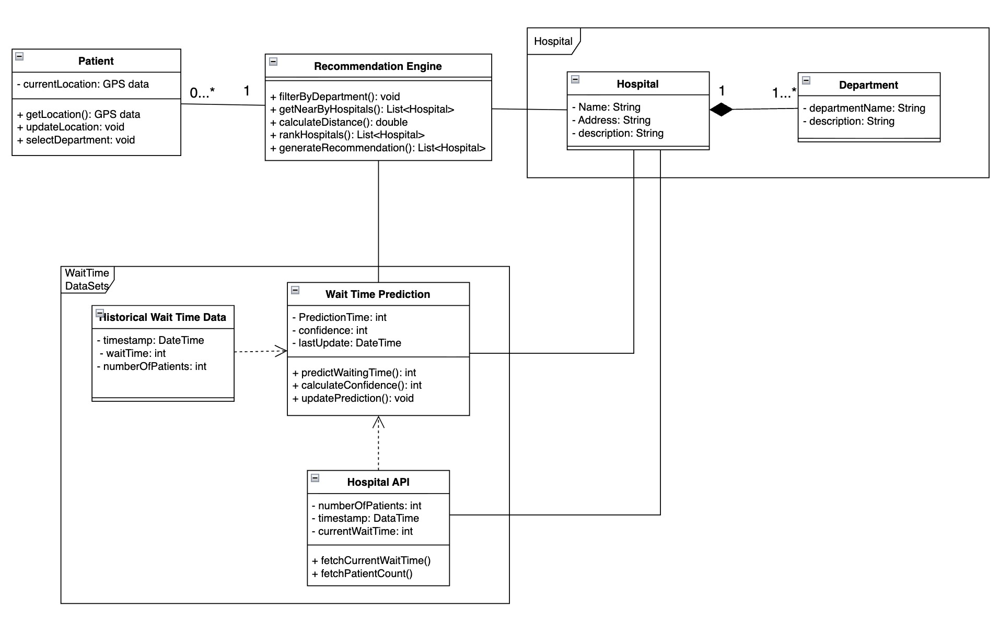
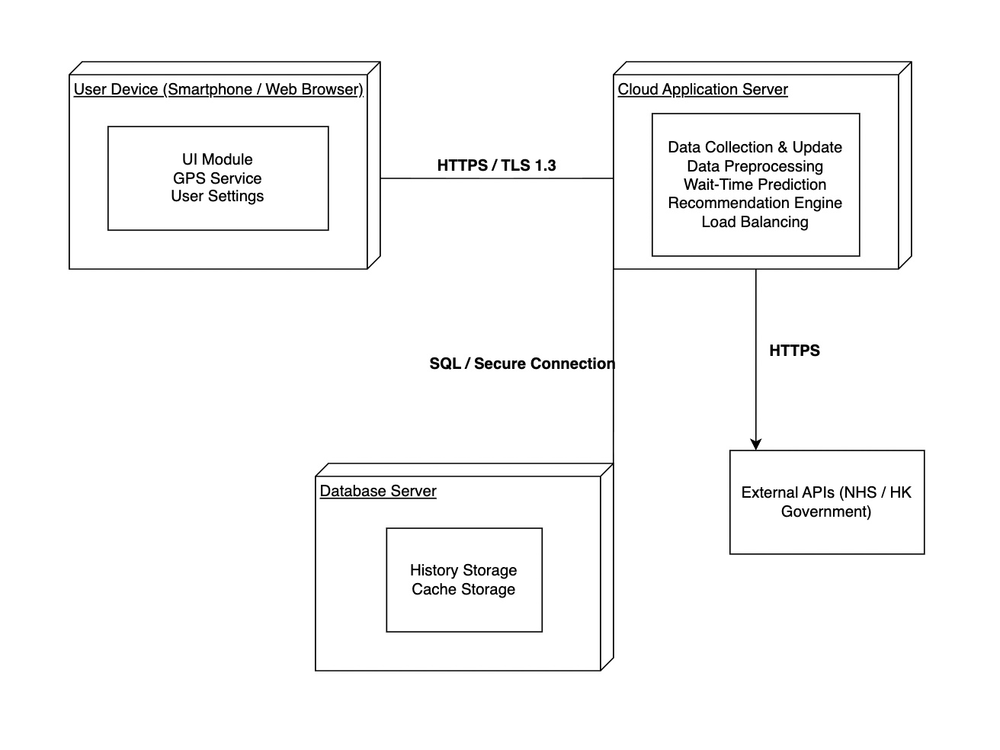

# Architecture gallery

These diagrams document the system the team designed around the CarePath Navigator prototype. They include both high-level architecture and detailed interaction models.

Some diagrams retain NHS labels from the project's early data-source exploration. The team's final reported model evaluation used Hong Kong public hospital data, and not every planned service shown here was implemented in the live prototype.

## System context

The patient shares search preferences and location data, while the system combines facility information and queue data to return recommendations.

## Container architecture

The proposed application separates the React/TypeScript client, Flask application services, prediction service, and relational data storage.

## Component architecture

## Data pipeline

The proposed pipeline validates, anonymizes, preprocesses, predicts, ranks, and formats hospital options before displaying them to the user.

## User interaction sequence

## Application states

## Use cases

## Domain model

## Proposed deployment

